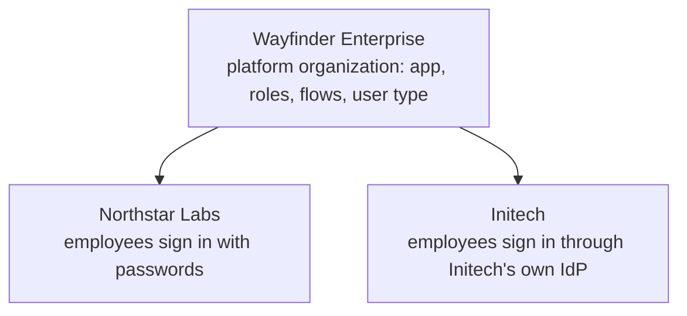

:::note[🎯 What you'll learn]

- Why a B2B product needs more than a `company` field on each user
- How ThunderID models each customer company as an **organization**
- The five journeys every B2B product ends up needing, and how ThunderID covers each

This builds directly on [module 12, Organization units](/docs/next/intermediate/organization-units).

:::

## The idea

A consumer app has one kind of customer: a person. A business (B2B) product sells to **companies**, and that raises questions a consumer app never faces:

- Which company is this person acting for right now?
- How did they come to belong to that company, and who decided it?
- What may they do there, and only there?
- Who runs each company's team: you, or the company's own admin?

A first version usually adds a `company` field to every user and checks it everywhere. That breaks down quickly: people who work for several companies, companies that insist on their own sign-in, admins who want to manage their own team.

ThunderID's answer is to make each customer company an **organization**: an [organization unit](/docs/next/intermediate/organization-units) that represents a customer. The product's app, roles and flows are defined once, above all the companies, and shared down to each of them.

:::info[🧳 In Wayfinder Enterprise]

Wayfinder sells a corporate travel product, **Wayfinder Enterprise**, with two customers:

The application, its two roles (`Wayfinder Admin` and `Wayfinder Member`) and its sign-in flow live in the platform organization and are shared with every company. A new company works the moment it signs up.

:::

## The five B2B journeys

| Journey | The problem | How ThunderID does it |
| --- | --- | --- |
| **Company sign-up** | A new customer wants to create their company and its first admin in one visit, with no sales call | A sign-up flow built from the **Organization Sign-up** template creates a new OU under the platform organization and the admin's account, and assigns the admin role |
| **Invite people** | The company admin brings the team in, including people who already have an account | An **invitation** flow (`INVITATION` flow type): the admin names a person by email and picks roles, and accepting the link shares the person into the organization |
| **Enterprise sign-in** | A larger customer requires its employees to sign in through its own IdP (Okta, Entra ID and so on) | One shared sign-in flow with a variable, `enterpriseIdp`. Each company sets its own OIDC connection as the value. |
| **Delegated admin** | Each company's admin manages its own people, without ever seeing another company's | Your backend pins every management call to the admin's organization, and ThunderID confines permissions to the OU the token names |
| **Switch organizations** | A consultant works for several companies with one account | The account lives in the platform organization and is shared into each company. Tokens always name the organization they act for. |

## How the pieces fit

- **One account, or one per company?** The **Organization Sign-up** template creates the admin's account inside the new company. The **Organization Sign-up with Shared Account** template keeps the account in the platform organization and shares it in, so the same person can later join other companies.
- **Organization-aware tokens.** A sign-in lands in one organization, and the token carries `ouId`, `ouHandle` and `ouName`. Your API uses those to keep each company's data apart.
- **Signing in to a specific company.** An employee types their organization's handle (Ex: `initech`). ThunderID resolves it, reads that organization's value of `enterpriseIdp`, and redirects to Initech's IdP.
- **You can only grant what you hold.** Assigning a role or adding a group member that would grant more than the caller holds fails with `403` and `SAZ-4030`.
- **Switching without signing in again.** The SDK tries a device secret first (the `device_sso` scope), then a silent sign-in with `prompt=none`, and only then a full redirect to the other organization's sign-in.

## 🧪 Lab

Run the [Wayfinder Enterprise sample](https://thunderid.dev/docs/next/use-cases/b2b/try-it-out), then work through its journeys in order:

1. [Let companies sign up](https://thunderid.dev/docs/next/use-cases/b2b/journeys/organization-sign-up)
2. [Invite people in](https://thunderid.dev/docs/next/use-cases/b2b/journeys/invite-members)
3. [Plug in an enterprise IdP](https://thunderid.dev/docs/next/use-cases/b2b/journeys/enterprise-sso)
4. [Let organization admins manage teams](https://thunderid.dev/docs/next/use-cases/b2b/journeys/delegated-administration)
5. [Switch organizations](https://thunderid.dev/docs/next/use-cases/b2b/journeys/switch-organizations)

After each one, decode the token and check which organization it names.

## Recap

- Each customer company is an **organization**: an OU under a platform organization.
- The app, roles and flows are defined once and **shared** down to every company.
- Company sign-up, invitations, enterprise IdPs, delegated admins and switching are all built from flows, sharing and organization-aware tokens.

Go deeper: [B2B use case](https://thunderid.dev/docs/next/use-cases/b2b/overview), [Learn the B2B model](https://thunderid.dev/docs/next/use-cases/b2b/concepts), [Resource sharing](https://thunderid.dev/docs/next/key-concepts/resource-sharing).
