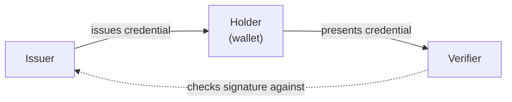

:::note[🎯 What you'll learn]

- What a verifiable credential is, and the three roles around it
- How ThunderID issues credentials and verifies them, including wallet sign-in

:::

## The idea

A **verifiable credential** (VC) is a signed statement about someone, such as "over 18" or "employee of Acme", that they keep in a digital wallet on their phone and present when needed. Nobody has to call the issuer to check it: the signature proves it's genuine.

Three roles take part:

ThunderID can play both the **issuer** and the **verifier**.

:::info[🧳 In Wayfinder]

Wayfinder issues its member John Doe a **Sky Pass** loyalty credential into his mobile wallet. Later, John presents it at the **Skyline Lounge**, a separate business that never calls Wayfinder. The lounge asks ThunderID to verify the pass and lets John in by his tier.

:::

## How ThunderID does it

| Role | Standard | In ThunderID |
| --- | --- | --- |
| Issuer | [OpenID4VCI](https://openid.net/specs/openid-4-verifiable-credential-issuance-1_0.html) | Credential configurations at `/openid4vci/credential-configurations` (format `dc+sd-jwt`). Wallets use `/.well-known/openid-credential-issuer`, credential offers, `/openid4vci/nonce` and `/openid4vci/credential`. |
| Verifier | [OpenID4VP](https://openid.net/specs/openid-4-verifiable-presentations-1_0.html) | Presentation definitions at `/openid4vp/presentation-definitions`. A flow verifies a wallet presentation with `OpenID4VPVerifyExecutor`, so presenting a credential can be a sign-in method. |

## Setup gotchas

- Issuance offers use the authorization code grant only, and an offer lives 5 minutes.
- The wallet's application must be created from the `wallet` or `wallet-embedded` template. The issuer refuses other clients.
- Verification needs `client_id_scheme` and a `signing_key_id` backed by an X.509 certificate.

## 🧪 Lab

Run the [VC try-it-out](https://thunderid.dev/docs/next/use-cases/vc/try-it-out): set up the sample, issue a credential, then verify it.

## Recap

- A VC is a signed claim the holder keeps and presents. The signature is what makes it trustworthy.
- ThunderID issues with **OpenID4VCI** and verifies with **OpenID4VP**.
- A wallet presentation can be a step in a sign-in flow.

Go deeper: [OpenID4VCI](https://thunderid.dev/docs/next/guides/protocols/openid4vc/openid4vci), [OpenID4VP](https://thunderid.dev/docs/next/guides/protocols/openid4vc/openid4vp), [Decentralized identity use case](https://thunderid.dev/docs/next/use-cases/vc/overview).
