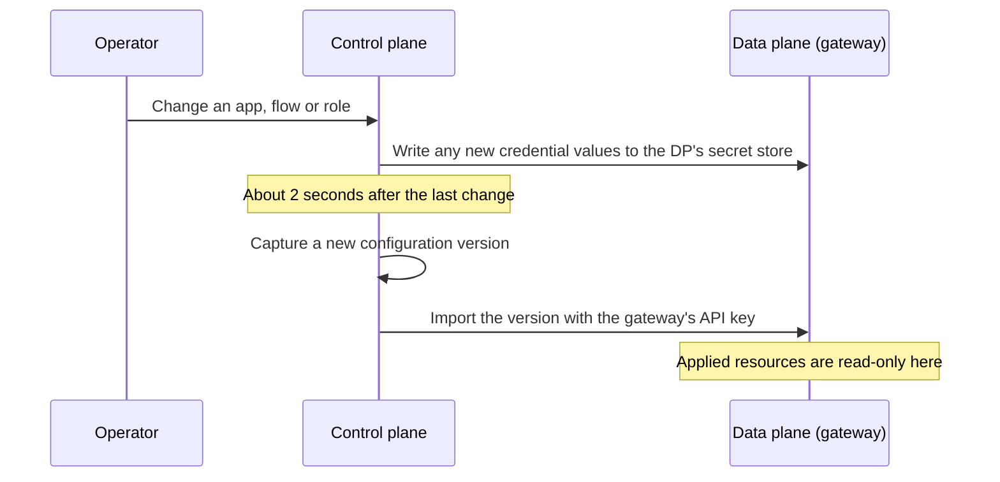

:::note[🎯 What you'll learn]

- What the control plane and the data plane each do, and why they're separate
- How a change on the control plane reaches a data plane
- What a **project** is, and what it isn't

:::

## The idea

Imagine Wayfinder runs sign-in in three regions. Configuring each region's server by hand means three chances to get it wrong. ThunderID splits the job: the **control plane** (CP) is the one place you author configuration, and it pushes versioned snapshots to the **data planes** (DPs) it manages, where people actually sign in. By default a control plane registers one data plane (`gateway.max_gateways`), and only the default gateway receives credential values. They're two builds of one codebase: `backend/cmd/cpserver` and `backend/cmd/server`.

| | Control plane | Data plane |
| --- | --- | --- |
| Serves | Management APIs and the Control Plane Console | OAuth 2.0/OIDC, flows, the Direct API, Gate, the Admin Console, and its own management API |
| Sign-in traffic | None. The sign-in packages aren't even compiled in, and a test enforces it. | All of it |
| Its console's users sign in through | A separate data plane, such as `auth-dp` in the quickstart | The data plane's own Gate |
| Holds | Projects, gateways, configuration versions | The configuration applied to it, plus its users and runtime data |

## How a change reaches a data plane



- A **gateway** is a data plane registered with a control plane.
- Credentials never travel in the bundle. The bundle refers to them with `sec:` ([module 18](/docs/next/advanced/declarative-config)).
- Auto-apply is off by default and on in the quickstart pack. Without it, apply a version yourself with `POST /gateways/{id}/apply`. You can also diff and revert a gateway.

## Projects

A **project** groups configuration on the control plane, Ex: one per product or team.

- **Project-level:** applications, agents, flows, organization units, themes, layouts, notification templates, intents (authorization detail types) and verifiable credential configurations
- **Organization-level:** user types, agent types, connections
- **Either:** users, groups, roles, resource servers
- **Deployment-level:** translations, server config, variables, secrets

A project isn't an isolation boundary. The data plane stores the `projectId` it receives and only uses it to filter management lists. Sign-in and tokens never look at it. If you need isolation, use separate deployments.

## 🧪 Lab

1. Create a project in the Control Plane Console, and an app inside it.
2. List the versions and find the one your change produced:

```bash
curl -sk $CP/configuration-versions -H "Authorization: Bearer $TOKEN" | jq
```

3. List the gateways, then check which version one has applied: `GET $CP/gateways/<id>/applied-version`.
4. Try to edit the synced app through the data plane's management API, and see it refused. You need a data plane token for this: `$TOKEN` is issued by `auth-dp` for the control plane, so the data plane answers `401`. Copy a token from the Admin Console ([https://localhost:8090/console](https://localhost:8090/console)) the same way as in [Lab 0](/docs/next/beginner/lab-0#step-4-get-a-token-for-the-api-labs). The data plane refuses the edit with `400 APP-1069`.

## Recap

- The **control plane** authors. **Data planes** run sign-in.
- Changes travel as **configuration versions**, applied to registered **gateways**.
- A **project** organizes configuration. It doesn't isolate anything.

Go deeper: [Configuration versions](https://thunderid.dev/docs/next/guides/declarative-configurations/configuration-versions), [Centralized configuration](https://thunderid.dev/docs/next/use-cases/managed-deployments/centralized-configuration), [Trusted issuer](https://thunderid.dev/docs/next/guides/trusted-issuer), [CP/DP design spec](https://github.com/thunder-id/thunderid/tree/main/docs-internals/control-plane-data-plane-separation).
