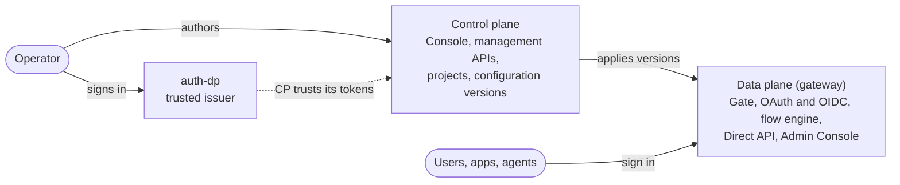

ThunderID is an open source IAM stack for humans, AI agents and machines. It's an [LF Decentralized Trust](https://www.lfdecentralizedtrust.org/) project, written in Go (backend) and React (frontends), licensed Apache 2.0.

Design goals from the [README](https://github.com/thunder-id/thunderid#readme):

- **Agent-native identity:** AI agents are first-class identities, not service accounts in disguise.
- **Decentralized identity:** issue and verify verifiable credentials with digital wallets.
- **Post-quantum ready:** crypto-agile signing, including ML-DSA keys.
- **Lightweight and GitOps friendly:** a single binary, with every resource definable in YAML.

## The moving parts

| Part | What it is | Who uses it |
| --- | --- | --- |
| Data plane (DP) | The server that runs sign-in. OAuth 2.0 / OIDC endpoints, the flow engine, the Direct API, and the management API it receives configuration through. | End users, applications, agents |
| Control plane (CP) <V2 /> | The server where configuration is authored. Serves management APIs only, no sign-in traffic. Captures configuration versions and applies them to the data planes it manages. | Operators, CI pipelines |
| Gate | The hosted sign-in, sign-up and recovery UI, served by the data plane at `/gate`. | End users |
| Admin Console | The data plane's console at `/console`: users, agents, groups, roles, organization units. | Service desk admins |
| Control Plane Console <V2 /> | The control plane's console: applications, flows, connections, roles, users, projects. | Operators |
| SDKs | Client libraries for JavaScript, iOS, Android and Flutter. | App developers |

*Operators author on the control plane, which applies configuration versions to its data planes. Everything users, apps and agents touch runs on a data plane.*

The split exists so configuration is authored once, versioned, and rolled out to many data planes. A data plane can still run alone: everything is reachable through its REST API and YAML.

Go deeper: [ARCHITECTURE.md](https://github.com/thunder-id/thunderid/blob/main/ARCHITECTURE.md), [Use cases](https://thunderid.dev/docs/next/use-cases/overview).
