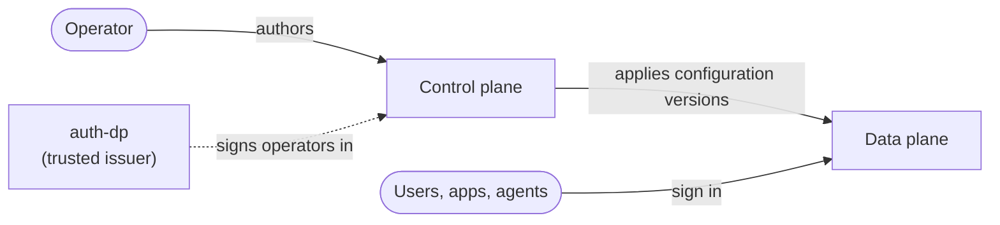

:::note[🎯 What you'll learn]

- What ThunderID is built for
- The parts you'll meet in the labs, and what each one does

:::

## The idea

ThunderID is an open source IAM stack for **humans, AI agents and machines**. It's an [LF Decentralized Trust](https://www.lfdecentralizedtrust.org/) project, written in Go (backend) and React (frontends), and licensed under Apache 2.0.

Its design goals, from the [README](https://github.com/thunder-id/thunderid#readme):

- **Agent-native identity.** AI agents are first-class identities, not service accounts in disguise.
- **Decentralized identity.** Issue and verify verifiable credentials held in digital wallets.
- **Post-quantum ready.** Crypto-agile signing, including ML-DSA keys.
- **Lightweight and GitOps friendly.** A single binary, with every resource definable in YAML.

## The moving parts

Think of ThunderID as two kinds of server. One is where you **configure** things. The other is where people actually **sign in**.

| Part | What it is | Who uses it |
| --- | --- | --- |
| **Data plane** (DP) | The server that runs sign-in: the OAuth 2.0 and OIDC endpoints, the flow engine and the Direct API. It also has a management API that receives configuration. | End users, apps, agents |
| **Control plane** (CP) | The server where configuration is authored. It serves management APIs only and never handles a sign-in. It captures configuration versions and applies them to the data planes it manages. | Operators, CI pipelines |
| **Gate** | The hosted sign-in, sign-up and recovery screens, served by the data plane at `/gate`. | End users |
| **Admin Console** | The data plane's console at `/console`, for users, agents, groups, roles and organization units. | Support and admin staff |
| **Control Plane Console** | The control plane's console, for applications, flows, connections, roles, users and projects. | Operators |
| **SDKs** | Client libraries for JavaScript, iOS, Android and Flutter. | App developers |

The split exists so configuration is written once, versioned, and rolled out to many data planes. A data plane can still run on its own: everything is reachable through its REST API and YAML. [Module 19](/docs/next/advanced/control-plane-data-plane) goes deeper.

:::info[🧳 In Wayfinder]

Wayfinder's operators configure it on the control plane: its users' schema, its app registration, its sign-in journey. Travelers never touch the control plane. When they sign in, the Wayfinder app sends them to a data plane, where Gate shows the sign-in screen.

:::

## Recap

- ThunderID is IAM for humans, AI agents and machines.
- The **data plane** runs sign-in. The **control plane** is where you author configuration.
- **Gate** is the sign-in UI. Each plane has its own console.

Go deeper: [ARCHITECTURE.md](https://github.com/thunder-id/thunderid/blob/main/ARCHITECTURE.md), [Use cases](https://thunderid.dev/docs/next/use-cases/overview).
