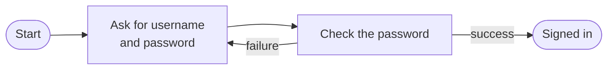

:::note[🎯 What you'll learn]

- What a **flow** is, and why ThunderID models every journey as one
- How to read a flow: prompts, tasks and the paths between them
- How a flow change reaches your app with no code change

:::

## The idea

Signing in isn't one step. It might be: ask for a username, check the password, ask for a one-time code, check it, then decide whether this person may use this app. Sign-up, password recovery and sign-out are journeys too.

ThunderID describes each journey as a **flow**: a small graph of steps stored on the server. When someone signs in, ThunderID runs the flow, one step at a time. Your app doesn't contain the steps, so you can add multi-factor sign-in or a consent screen and every app picks it up on its next sign-in.



:::info[🧳 In Wayfinder]

Wayfinder starts with ThunderID's bundled sign-in flow, `default-flow`: ask for a username and password, check them, sign the traveler in. Later you'll give Wayfinder its own flows for sign-up, password recovery and sign-out ([module 9](/docs/next/intermediate/building-journeys)), and the Wayfinder app won't change at all.

:::

## Reading a flow

A flow is made of **nodes**. You'll meet two kinds first:

- A **prompt** node shows a screen: the inputs to collect (Ex: username, password) and the actions the user can take (Ex: Continue, Forgot password).
- A **task** node does work by running an **executor**. `CredentialsAuthExecutor` checks a password. `ProvisioningExecutor` creates a user. `OTPExecutor` sends and checks a one-time code.

A task's outcome decides where the flow goes next: `onSuccess`, `onFailure`, or `onIncomplete` when it needs more input. A flow also has a start and an end. There's no separate "decision" node: branching comes from these outcomes and from the actions on a prompt.

## Where you edit flows

The **Flow Builder** in the console is a drag-and-drop editor over the same JSON. It has ready-made **widgets** that drop in a group of nodes at once, such as a consent screen. Every save creates a new version, and you can roll back.

## 🧪 Lab

1. List the sign-in flows and open the default one:

```bash
curl -sk "$CP/flows?flowType=AUTHENTICATION" -H "Authorization: Bearer $TOKEN" | jq
```

2. In the JSON of `default-flow`, find:
   - the `PROMPT` node that asks for `username` and `password`, and its action `action_001`
   - the `TASK_EXECUTION` node that action leads to, and the executor it runs
   - that node's `onSuccess`
3. Open the same flow in the Control Plane Console's Flow Builder and find the same nodes on the canvas.
4. Change the sign-in screen's title text and save. Sign in to your React app from [module 5](/docs/next/beginner/applications) again and see the new title, with no change to the app.

## Recap

- A **flow** is a server-side graph of steps for one journey.
- **Prompt** nodes collect input. **Task** nodes run **executors** that do the work.
- Change the flow and every app using it changes with it.

Go deeper: [What are flows](https://thunderid.dev/docs/next/guides/flows/what-are-flows), [Flow concepts](https://thunderid.dev/docs/next/guides/flows/flow-concepts), [Build a flow](https://thunderid.dev/docs/next/guides/flows/build-a-flow).
