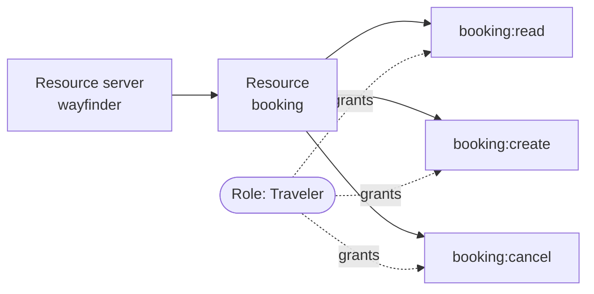

:::note[🎯 What you'll learn]

- How ThunderID describes the APIs you protect
- How roles turn into the `scope` of an access token
- What AuthZEN is, in one paragraph

:::

## The idea

Signing someone in tells your API *who* is calling. It doesn't say what they may do. ThunderID answers that with **role-based access control (RBAC)**: you describe your API's actions as permissions, bundle permissions into roles, and give roles to people. At sign-in, ThunderID puts the caller's permissions into the access token, and your API checks them on every request without calling ThunderID.

:::info[🧳 In Wayfinder]

Every customer gets the `Traveler` role, so a customer's access token carries `scope: booking:read booking:create booking:cancel`. The booking API reads that and lets them manage their own trips.

:::

## The four building blocks

| Block | What it is | Wayfinder |
| --- | --- | --- |
| **Resource server** | An API you protect. Its `identifier` becomes the token's `aud`. | The booking API |
| **Resource** | A noun the API deals with. Resources can nest. | `booking` |
| **Action** | A verb on a resource. Each action becomes a permission: the resource's permission, a delimiter (default `:`), then the action's handle. | `read`, `create`, `cancel` |
| **Role** | A set of permissions, assigned to users, agents, apps or groups | `Traveler` |

On a **hierarchical** resource server <V2 />, holding a parent permission also covers its children.

## How a permission ends up in a token

1. The app asks for scopes and names the API with the `resource` parameter. With no `resource`, the configured default resource server is used. With neither, a permission scope fails with `invalid_target`.
2. ThunderID drops any requested scope that resource server doesn't define. Unknown scopes vanish silently, so check your spelling.
3. The flow's **Authorization** step checks the remaining scopes against the user's roles in the organization unit they signed in to. The default sign-in flow includes this step.
4. The access token's `scope` holds only what was granted, and its `aud` is the resource server's identifier.

The consoles work the same way. The bootstrap **System** resource server defines the `system` permission, and the bootstrap Administrator role grants it to the Administrators group. That's why the token you copied in [Lab 0](/docs/beginner/lab-0) works on the management API.

## AuthZEN in one paragraph

Sometimes an API needs to ask "may this subject do this action on this resource?" at the moment of the call, not just read a token. ThunderID answers that as an [AuthZEN](https://openid.net/wg/authzen/) Policy Decision Point: `POST /access/v1/evaluation` decides from the same roles. A resource server can also hand its decisions to an external AuthZEN service <V2 />.

## 🧪 Lab

1. Create a resource server with identifier `https://api.example.com/booking`, a resource `reservations` and an action `create`. That gives the permission `reservations:create`.
2. Create a role with `reservations:create` and assign it to your test user.
3. Sign in through your app with `scope=openid reservations:create` and `resource=https://api.example.com/booking`.
4. Decode the access token and check `scope` and `aud`. Then remove the role, sign in again and compare.

:::info[🧭 Wayfinder step]

Do [Define access](https://thunderid.dev/docs/next/use-cases/b2c/build-access): the `wayfinder` resource server, its `booking` permissions and the `Traveler` role.

:::

## Recap

- **Resource server → resource → action** gives you permission strings like `booking:read`.
- **Roles** bundle permissions and are assigned to users, agents, apps or groups.
- The token's `scope` holds only granted permissions, and `aud` names the API.

Go deeper: [Authorization](https://thunderid.dev/docs/next/key-concepts/authorization), [Resource servers](https://thunderid.dev/docs/next/guides/resource-servers), [Manage roles](https://thunderid.dev/docs/next/guides/users/manage-roles), [AuthZEN](https://thunderid.dev/docs/next/guides/protocols/authzen).
