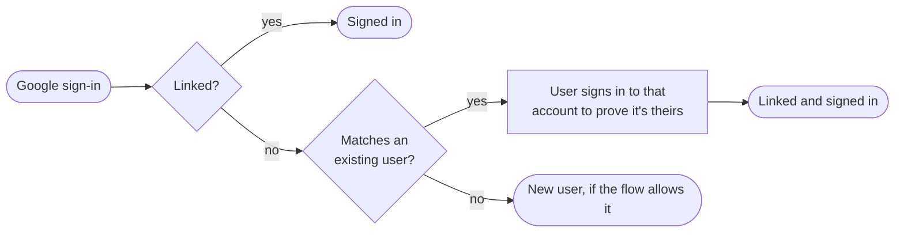

:::note[🎯 What you'll learn]

- What a **connection** is, and the kinds ThunderID supports
- How "Sign in with Google" works, including linking to an existing account
- Where OTP codes, magic links and recovery emails come from

:::

## The idea

Some steps in a journey need an outside system: Google to sign someone in, an SMS gateway to send a code, an email server to send a recovery link. A **connection** is ThunderID's saved configuration for reaching one of those systems. It's a separate resource so several flows can share one. An app never points at a connection directly: a flow step does.

:::info[🧳 In Wayfinder]

Wayfinder's recovery flow emails a recovery link through an SMTP **email provider** connection, using the `password-recovery` **notification template**. Wayfinder rewrites that template in its own wording and branding, with no server files to edit and no restart.

:::

## Kinds of connection

| Kind | Types | Used by |
| --- | --- | --- |
| Identity providers | `google`, `github`, `oidc`, `oauth` | Social and federated sign-in executors |
| SMS senders | `twilio`, `vonage`, `sms-gateway` | `SMSExecutor`, OTP |
| Email providers <V2 /> | `email-smtp` | `EmailExecutor`: magic links, invitations, recovery |
| HTTP connections <V2 /> | `http` | `ExtensionExecutor`, to call your own services from a flow |
| AuthZEN PDP <V2 /> | `authzen-pdp` | Resource servers that delegate decisions ([module 8](/docs/intermediate/authorization)) |

## Federation: signing in with another IdP

To let people sign in with Google, you do three things: create the Google connection, add a Google sign-in step to a flow, and assign that flow to the app.

When a Google identity arrives, ThunderID looks for a **link**: a record that this Google account belongs to a local user.

ThunderID never links on a matching email alone. The user first proves they own the matched account. Otherwise anyone who controls an IdP that lets you claim any email address could take over someone else's account.

## Notifications

OTP codes, magic links, invitations and recovery links all come from **notification templates**, one per message and channel (`email` or `sms`). Templates are written once and stay language-neutral: they use translation keys for the wording and design tokens for the branding.

There's no deployment-wide default sender. Each email or SMS step in a flow names the provider it sends through, so you can run one provider for customers and another for staff.

## 🧪 Lab

1. Follow [Add Google](https://thunderid.dev/docs/next/guides/identity-providers/add-google) and [Connect an IdP to an application](https://thunderid.dev/docs/next/guides/identity-providers/connect-idp-to-application).
2. Sign up with a password first, then sign in with Google using the same email address. Watch the link prompt.

:::info[🧭 Wayfinder step]

Do [Customize notifications](https://thunderid.dev/docs/next/use-cases/b2c/build-notifications): rewrite the recovery email in Wayfinder's voice.

:::

## Recap

- A **connection** is saved configuration for an outside system, used by flow steps.
- Federated sign-in links an outside identity to a local user, and only after the user proves ownership.
- Messages come from **notification templates**, sent through the provider each flow step names.

Go deeper: [Identity providers](https://thunderid.dev/docs/next/guides/identity-providers/overview), [Link accounts](https://thunderid.dev/docs/next/guides/identity-providers/link-accounts), [Email providers](https://thunderid.dev/docs/next/guides/notifications/email-providers), [Notification templates](https://thunderid.dev/docs/next/guides/notifications/templates).
