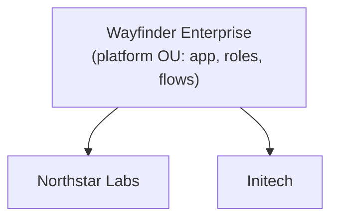

:::note[🎯 What you'll learn]

- What an **organization unit** (OU) is, and what lives in one
- How a sign-in lands in exactly one OU
- How one app or role can serve many OUs through sharing

:::

## The idea

So far everything you created lived in one place. Real deployments need boundaries: departments in a company, or one customer company each in a business product. An **organization unit** is a node in a tree that owns resources. Users, apps and roles live in an OU, and the tree shape lets a parent's resources be shared with the units below it.

:::info[🧳 In Wayfinder]

Wayfinder's consumer app keeps everything in the default OU: customers and staff are told apart by user type. OUs matter once Wayfinder sells to companies. In **Wayfinder Enterprise**, each customer company becomes its own OU under a platform OU, which is the subject of [module 15](/docs/advanced/b2b).



:::

## What lives in an OU

- **Owned resources:** users, agents, applications, groups, roles, user and agent types, connections and resource servers. Every user, agent and app belongs to exactly one OU.
- **Its own sign-in setup:** an OU can carry its own flows, theme, layout, logo and terms of service.
- **ID and handle:** every OU has a generated `id` and a human-friendly `handle`. A handle only has to be unique among its siblings, so a path like `acme/engineering` identifies an OU. `GET /organization-units/tree/{path}` resolves one.
- **The system OU:** the bootstrap OU (handle `default`), set by `server.system_ou_id`. A resource that names no OU lands there. It can't be deleted, and no OU can be deleted while child OUs, users or groups still depend on it.

## Signing in to an OU <V2 />

Every sign-in lands in exactly one OU, and both the user and the app must be found there.

- An app can name the OU with `/ou/{ouId}/oauth2/authorize` and `/ou/{ouId}/oauth2/token`, or with `ouId` on `/flow/execute`. These take the OU's ID, not its handle.
- Or a **Resolve OU** step in the flow decides it after the user is identified. Put it before the Authorization step, so only that OU's role assignments count.
- Tokens carry `ouId`, `ouHandle` and `ouName` claims, so your API knows which organization the caller is acting for.

## Sharing across OUs <V2 />

An application, user or role lives in one OU, but **sharing policies** make it usable in others:

- to **all units**
- to **child units**: all of them, or selected ones, each either alone or with its whole subtree
- to **other tree roots**

That's how one app serves many customer OUs without being copied. Groups are never shared.

## 🧪 Lab

```bash
curl -sk -X POST $CP/organization-units -H "Authorization: Bearer $TOKEN" \
  -H 'Content-Type: application/json' -d '{"handle":"acme","name":"Acme","parent":null}'
```

1. Create a child under it with `"parent":"<acme-id>"`, then resolve it by path: `GET $CP/organization-units/tree/acme/<child-handle>`.
2. In the console, share your React app into `acme`.
3. Create a user in `acme` and sign in through `/ou/<acme-id>/oauth2/authorize`. Decode the token and find `ouHandle`.

:::tip[Go further]

The [B2B sample](https://thunderid.dev/docs/next/use-cases/b2b/try-it-out) runs one OU per customer company. You'll use it in [module 15](/docs/advanced/b2b).

:::

## Recap

- An **OU** is a node in a tree that owns resources.
- A sign-in lands in **one OU**, and the token names it.
- **Sharing** lets one app, user or role serve many OUs.

Go deeper: [Manage organization units](https://thunderid.dev/docs/next/guides/organization-units/manage-organization-units), [Sign in to organization units](https://thunderid.dev/docs/next/guides/organization-units/sign-in-to-organization-units), [Resource sharing](https://thunderid.dev/docs/next/key-concepts/resource-sharing).
