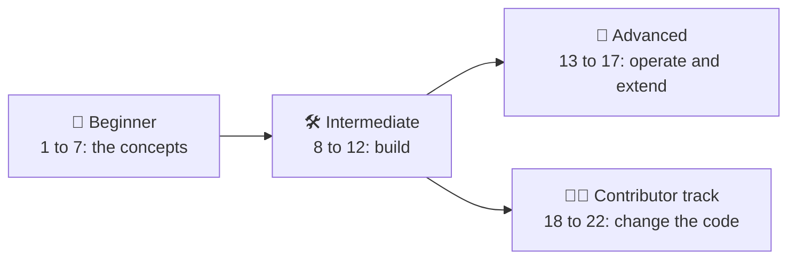

Learn ThunderID by running it. 22 short modules take you from "what's an access token?" to stepping through the flow engine in a debugger, with something hands-on in almost every one.

:::note[A community course]

This course is written by a ThunderID contributor. It isn't the official documentation. The [ThunderID docs](https://thunderid.dev/docs/next/) stay the reference: this course is the order to read things in, and the mental model the reference assumes you already have.

:::

## 🗺️ How this course works

| Level | For | You'll be able to |
| --- | --- | --- |
| [🌱 Beginner](/docs/beginner) | Everyone | Explain how ThunderID models organizations, identities, access and user journeys, and run it locally |
| [🛠️ Intermediate](/docs/intermediate) | Everyone | Register apps and agents, sign people in three different ways, and wire in identity providers and SDKs |
| [🚀 Advanced](/docs/advanced) | App builders and operators | Use the advanced protocols, verifiable credentials, GitOps-style configuration and the control plane |
| [🧑‍💻 Contributor track](/docs/contributor) | Anyone changing ThunderID itself | Find your way around the code, run and debug it from source, and get a PR merged |

Everyone takes Beginner and Intermediate. Then pick Advanced, the Contributor track, or both.

## 🧭 One storyline

You build the identity layer of **Wayfinder**, a sample travel app, as you go. The labs follow the docs' [Wayfinder Build It tutorial](https://thunderid.dev/docs/next/use-cases/b2c/build-index), so each module adds one visible piece: users, access rules, sign-in journeys, the app itself.

As you read, look for these markers:

- 🧭 **Wayfinder step:** a page of the Build It tutorial to do next.
- 🧪 **Lab:** an extra hands-on exercise (`curl`, console, code) the docs don't cover.
- ✅ **Checkpoint:** what you should be able to do before moving on, at the end of each level.
- <V2 /> marks what exists only on `main` (the 2.0 line, `v2.0.0-m1`), not in the 1.x releases.

## 🧰 What you need

- Git, Node.js LTS, `curl` and `jq` for the labs.
- Go and pnpm too, for the Contributor track.

Ready? Start with [1. IAM in ten minutes](/docs/beginner/iam-in-ten-minutes), or jump straight to [Lab 0](/docs/beginner/lab-0) if you already know OAuth.
