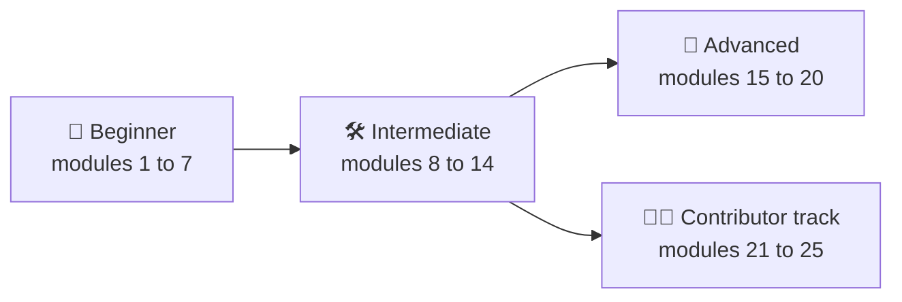

Learn ThunderID by running it. 25 short modules take you from "what's an access token?" to stepping through the flow engine in a debugger, with something hands-on in almost every one.

:::note[A community course]

This course is written by a ThunderID contributor. It isn't the official documentation. The [ThunderID docs](https://thunderid.dev/docs/next/) stay the reference: this course is the order to read things in, and the mental model the reference assumes you already have.

:::

## 🗺️ How this course works

| Track | For | You'll be able to |
| --- | --- | --- |
| [🌱 Beginner](/docs/next/beginner) | Everyone, including people new to IAM | Explain the basics, run ThunderID, and sign a user in to your own app |
| [🛠️ Intermediate](/docs/next/intermediate) | Everyone | Build a real app's identity: access rules, journeys, social sign-in, organizations and agents acting for users |
| [🚀 Advanced](/docs/next/advanced) | App builders and operators | Serve business customers, use the full protocol set, issue credentials and run ThunderID as code |
| [🧑‍💻 Contributor track](/docs/next/contributor) | Anyone changing ThunderID itself | Find your way around the code, run and debug it from source, and get a PR merged |

Everyone takes Beginner and Intermediate. Then pick Advanced, the Contributor track, or both.

## 🧭 One storyline

You'll build the identity layer of **Wayfinder**, a sample travel booking app.

- In **Beginner**, you get a quick win: your own React app signing people in, and Wayfinder's user model.
- In **Intermediate**, you build Wayfinder for real by following the docs' [Wayfinder Build It tutorial](https://thunderid.dev/docs/next/use-cases/b2c/build-index): access rules, journeys, the app, and an AI concierge that acts for travelers.
- In **Advanced**, Wayfinder sells to companies as **Wayfinder Enterprise**, and issues verifiable credentials.

As you read, look for these markers:

- 🧳 **In Wayfinder:** the concept, shown in the storyline.
- 🧭 **Wayfinder step:** a page of the Build It tutorial to do next.
- 🧪 **Lab:** a hands-on exercise (`curl`, console, code) of this course's own.
- ✅ **Checkpoint:** what you should be able to do before moving on, at the end of each track.

## 📈 Track your progress

Every module ends with a **Mark as complete** button, and each checkpoint has boxes to tick. The bar at the top of the page shows how far you've got, with a milestone for each finished track. Progress is saved in this browser only: a different browser or a private window starts fresh. See [My progress](/progress) for the full list.

## 🧰 What you need

- Git, Go, Node.js LTS and pnpm, to build ThunderID from `main` in [Lab 0](/docs/next/beginner/lab-0).
- `curl` and `jq` for the labs.

:::info[Which ThunderID]

This is the **Next** version of the course. It's built and tested against a pack built from `main`, and its docs links point to the docs' Next pages. The milestone releases trail `main`, so some labs fail on them.

:::

Ready? Start with [1. IAM in ten minutes](/docs/next/beginner/iam-in-ten-minutes), or jump straight to [Lab 0](/docs/next/beginner/lab-0) if you already know OAuth.
